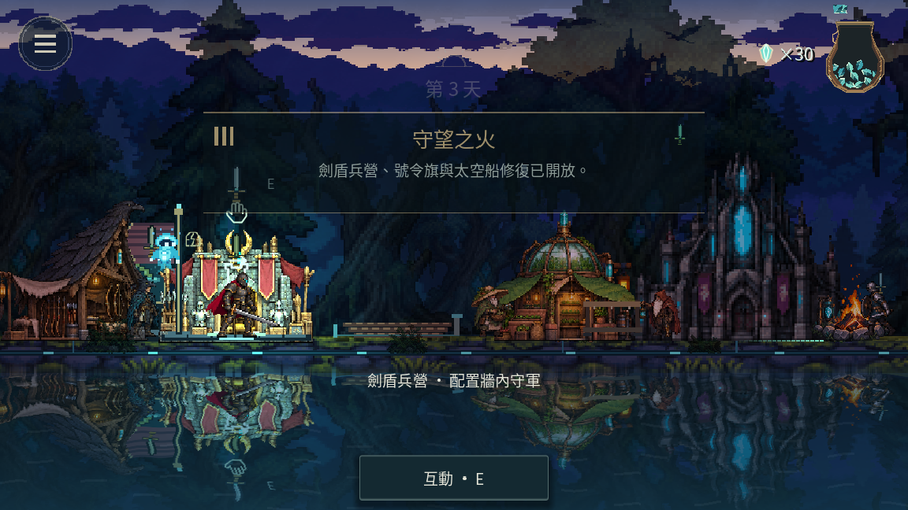
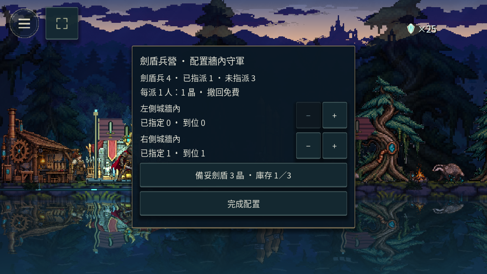

# 本機雙側劍盾防線驗收

2026-10-21，尚未公開發行。主遊戲與森林Demo共用本次程式；沒有執行Release、上傳附件或Pages部署。

- 最初重現14項失敗：既有／施工／首晶保留的建物可重疊付款，集結成員仍拾晶，以及缺少雙側劍盾指派。
- 最終目標案例75項通過，含舊無引導旅程可見介面的額外回歸、舊v24主／Demo檔載入、真實JSON接續與非法劍盾駐塔拒絕。
- 完整tools/check.sh通過，5055項核心斷言與全場景無SCRIPT ERROR／ERROR；最終舊旅程引導相容校對另跑完整核心，5057項全部通過，結果見final-core.log。
- 原生Main／Demo兵營互動各12項通過：E開面板、只顯示牆內兩側、派兵扣1晶、撤回免費、按裝備標示價格購具。已目視左兵營及守軍面板。
- 七地皆有有限、不同側的兵營位置；船距營火1870–3470像素，保留近郊範圍。
- 本機規格修訂89；三語目錄與指南同步。手機真機與原生Windows未新增驗收，本次未匯出平台包。

原始記錄：check.log、targeted.log、demo-native.log、main-native.log、seven-world-layout.log。
