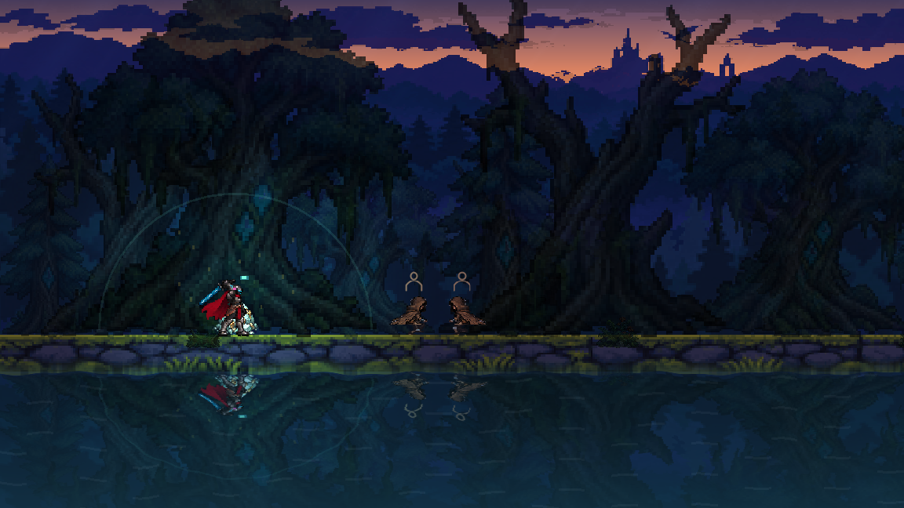
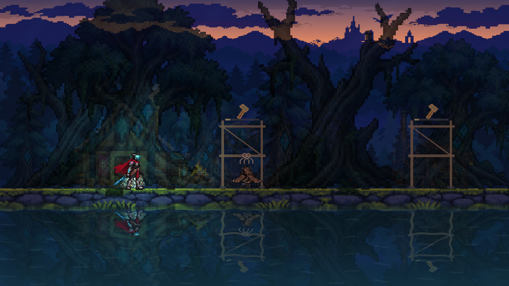
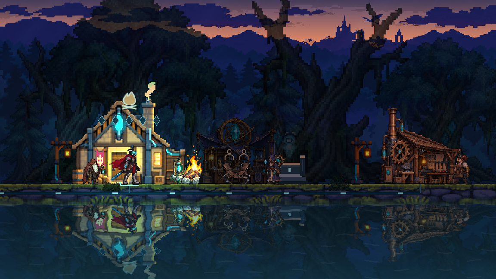
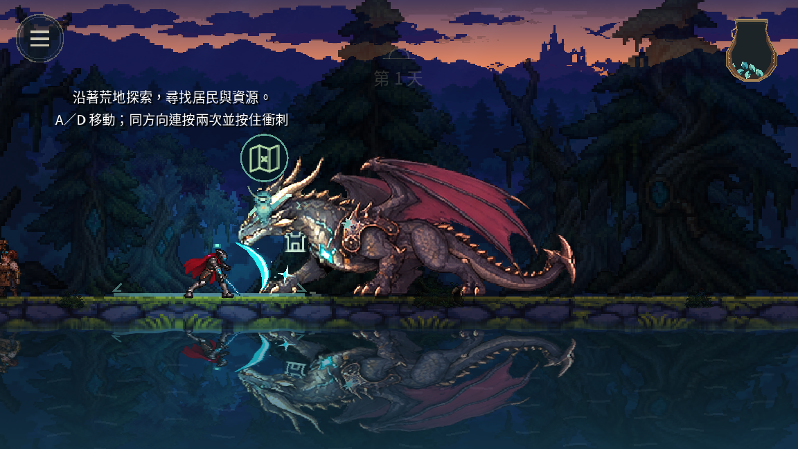

# v0.0.41 接觸與建營原生驗收

原生 macOS / Godot 4.7.2，1152×648。未寫入玩家旅程。

- 舊版成品的相同情境：左右小怪／守衛／龍共六個接觸失敗；測試已確認目前正式輕斬傷害為 18。`contact-v40-red.log` 為校正測試期待值後的紅燈證據。
- 修正後場景共 28 項：雙向身體邊緣、範圍外／背後不命中、重斬、每刀去重、真實舊存檔與中途存讀。正式傷害、體力與有效時間窗不變。
- 真實鍵盤 J 另外驗證三種敵人，保存首個命中影格。圖片的閃白代表正常受擊，並非換色設計。
- 拔劍場景共 10 項：移動／攻擊不打斷、暫停凍結、結束邊界不重疊、逐步組裝、恢復移動與重啟。
- `before-107.png` 是舊成品約 1.8 秒：角色仍跪著而建築已全出現。`after-107.png` 同時點只見拔劍；`after-155.png` 約 2.6 秒角色站立、營地才開始顯現；`after-209.png` 約 3.5 秒完整營地。

完整回歸與下載包驗證另記於 `../release-0.0.41/verification.json`；原生匯出成功不代表 Windows 或手機真機已驗收。
